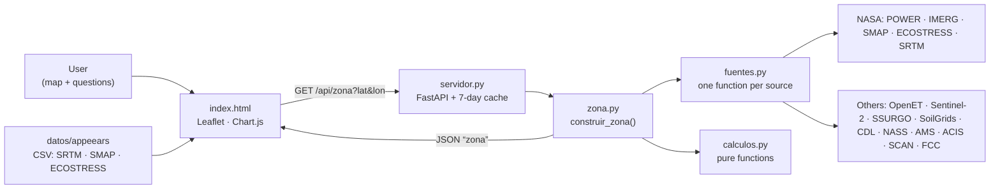

# 🌾 SatelliFarm — What should I plant?

**A farm advisor built on NASA satellite data.** From a point marked on a map of the United States, it recommends which crop to plant, how much water it will need and which risks the farmer should watch.

> Project by team **Nyam** for the **NASA Space Apps Challenge 2026**, challenge **Field Shift: Adapting Farms with NASA Data**.
> 🌐 Live site: **https://satellifarm.vercel.app**

---

## Contents

1. [Overview](#1-overview)
2. [Problem and solution](#2-problem-and-solution)
3. [How it works](#3-how-it-works)
4. [Architecture](#4-architecture)
5. [Data used and why](#5-data-used-and-why)
6. [Mathematical calculations](#6-mathematical-calculations)
7. [Repository structure](#7-repository-structure)
8. [Installation and usage](#8-installation-and-usage)
9. [Limitations](#9-limitations)
10. [Future work](#10-future-work)
11. [Team, credits and license](#11-team-credits-and-license)

---

## 1. Overview

The farmer marks the farm on the map, enters the field size and says what matters most (water, income, soil, forage, nitrogen). SatelliFarm queries data from NASA and other agencies, combines it and returns:

- The **recommended crops** for the chosen planting month, ranked by match, and the **not recommended** ones with the reason.
- An assessment of **water, climate, pests, soil and market**, with a risk level and concrete advice.
- **Three rotation strategies for the next 3 years**: what the farmer does today (according to satellite crop maps), their chosen crop in rotation, and a diversified option built around their priorities, compared on irrigation, nitrogen to buy, months of bare soil, pest-cycle break and income.
- A **climate scenario** with sliders (“what if it rains less or gets hotter?”) that recalculates every recommendation.
- An honest list of **“what we don’t know”**: which sources failed and what the farmer should confirm.

There are two profiles: **Farmer** (plain language) and **Engineer** (formulas, sources and technical values). Language (English/Spanish) and units (US/metric) are switched independently.

---

## 2. Problem and solution

**Problem.** Choosing a crop depends on many variables (rain, temperature, soil moisture, slope, soil, field history, prices) spread across different sources, with different formats and units. A small producer can rarely gather and interpret them.

**Solution.** SatelliFarm gathers those sources in a single query per point, **fuses them weighting how much each one can be trusted**, calculates the water balance of every crop and turns it into an explained recommendation, with the formulas in plain sight for anyone who wants to check them.

---

## 3. How it works

1. **Role.** Farmer or Engineer.
2. **Location and area.** The point is marked on the map (Leaflet) or taken from the browser’s geolocation, which the user must confirm. The point is validated to be in the contiguous US (lat 24.5° to 49.5°, lon −125° to −66.9°) and the field area is requested.
3. **Priorities.** The user weights water, income, soil, forage and nitrogen.
4. **Recommendation.** With the chosen planting month, the app filters the viable crops, calculates their water balance and a match score, and shows recommended and not recommended crops.
5. **Questions.** A short questionnaire (irrigation, previous crop, pests, erosion, waterlogging, bare soil) confirms or corrects what the satellites say. Some answers arrive pre-filled from the data (for example, the bare-soil months come from NDVI).
6. **Results.** Five assessments (water, climate, pests, soil, market), the **3-year rotation strategies** (each with a 36-month monthly timeline and, for each strategy, the reasoning, evidence, benefits, information gaps and risks to review locally) and the information gaps.
7. **Climate scenario (optional).** On the recommendation and results screens, two sliders (rain −40 % to +30 %, temperature −1 to +4 °C) let the user test a drier or hotter future. Everything is recalculated instantly.

The application always works **online**: the page (deployed on Vercel) queries the server, which gathers all the data sources, fuses them and caches each result for 7 days per ~1 km cell.

---

## 4. Architecture



**Design principles**

- **A single contract.** `zona.py` produces a JSON (the “zone”) with climate, anomalies, actual ET, NDVI, soil, crop history, yields and prices. The page only reads that contract.
- **Nothing fails silently.** Each source attempts its query; if it fails a backup is used and the reason (`sin_clave`, `sin_datos`, `sin_estaciones`, `datos_incompletos`, `error`) is stored in the `fuentes` field, which the page displays as “what we don’t know”.
- **NASA POWER is the backbone.** It is global, free and needs no key. If POWER fails the zone cannot be built.
- **Calculations separated from the network.** All the math lives in `calculos.py`, with no internet, so it can be tested offline.

---

## 5. Data used and why

Each source answers a question that no other source can answer alone.

### 5.1 NASA data

| Source | Resolution | What it provides | Why it is needed |
|---|---|---|---|
| **POWER** | ~50 km | Temperature (mean, max, min), rain, relative humidity, wind, solar radiation; monthly normals and a daily series since 2001 | It is the climate baseline and has everything FAO-56 requires to compute reference evapotranspiration. The daily series gives frost days and the anomaly of the last 90 days. |
| **GPM-IMERG** (via Earth Engine) | ~10 km | Monthly rain 2001–2024, rain of the last 90 days and its estimated error | Provides rain measured from space and a per-month uncertainty, used to weight it when fusing with other sources. |
| **SMAP L4** (via Earth Engine) | 9 km | Surface soil moisture; 30-day mean compared with the same 30 days of every year since 2016 | Confirms whether the soil is drier or wetter than normal. Rain alone cannot tell. |
| **ECOSTRESS** (L2T LSTE, via earthaccess) | 70 m | Summer land surface temperature, daytime passes only (10:00–16:00 solar time), discarding values outside 0–70 °C | Air is measured at 2 m, but the surface can be much hotter. A surface far above the air temperature indicates plants that are not transpiring enough. |
| **SRTM** | 30 m | Elevation and slope (%) around the field | Slope is a main driver of erosion. |
| **AppEEARS** (CSV) | points | Export of SRTM, SMAP and ECOSTRESS (`ECO_L3T_JET`, BESSinst layer) for 19 US points | Allows the use of NASA data from the nearest points even when the backend has no Earth Engine. The page accepts new CSVs and replaces a repeated layer instead of duplicating it. |

### 5.2 Other sources

| Source | What it provides | Why it is needed |
|---|---|---|
| **OpenET** (6-model Ensemble, 30 m; gridMET) | ET₀, actual field evapotranspiration and gridMET rain | Actual ET shows how much water the field consumed and allows detecting irrigation. gridMET ET₀ and rain (stations at 4 km) are better inputs than a 50 km model. |
| **Sentinel-2** (Copernicus / Earth Engine) | Typical monthly NDVI (10 m, 3 years, cloud and shadow free) and NDVI and slope PNG layers | Shows when the field is green and when it is bare (erosion risk, window for a cover crop). |
| **USDA SSURGO** | Texture, drainage, organic matter, hydrologic group, slope, erodibility (K), available water, pH | Determines how much water the soil holds, how much runs off and how erodible it is. |
| **ISRIC SoilGrids** | Total nitrogen, organic carbon and pH at 0–5 cm | Nitrogen and carbon exist only here. It first uses its REST API and, if that fails, the WCS service. |
| **USDA CDL** | Crop of each of the last 3 years at that point | Rotation: repeating a crop or family increases pests; a previous legume leaves nitrogen. |
| **USDA NASS** | 5-year average yield (county, or state if missing) and monthly prices | Estimates the expected gross income of each crop. |
| **USDA AMS** (optional) | Daily cash prices | Replace the NASS monthly price when reports are configured. |
| **ACIS / CoCoRaHS** | Nearby rain gauges (radius ~0.5°): monthly normals and 90-day rain | Correct the satellites with ground measurements. |
| **USDA SCAN** | Soil moisture at the 3 nearest stations (up to 150 km) | Validates SMAP moisture with real probes. |
| **FCC Area API** | County and state of the point | To query NASS and name the zone. |
| **FAO ECOCROP, FAO-56, USDA calendars** | Tmin, Tmax, Kc, cycle length, planting months, optimal pH, frost tolerance | The “crop table” (10 crops) against which every location is compared. |

---

## 6. Mathematical calculations

### 6.1 Reference evapotranspiration (FAO-56 Penman-Monteith)

When OpenET is not available, ET₀ is computed from POWER data (`calculos.py`). It is evaluated for the middle Julian day of each month and multiplied by the days in the month.

```text
T      = (Tmax + Tmin) / 2
e°(T)  = 0.6108 · exp(17.27·T / (T + 237.3))            saturation vapor pressure
es     = (e°(Tmax) + e°(Tmin)) / 2
ea     = es · RH / 100
Δ      = 4098 · e°(T) / (T + 237.3)²                    slope of the vapor pressure curve
P      = 101.3 · ((293 − 0.0065·z) / 293)^5.26          atmospheric pressure (z = elevation)
γ      = 0.000665 · P                                   psychrometric constant

Ra     = (24·60/π) · 0.0820 · dr · [ωs·sin φ·sin δ + cos φ·cos δ·sin ωs]   extraterrestrial radiation
Rso    = (0.75 + 2·10⁻⁵·z) · Ra                         clear-sky radiation
Rns    = (1 − 0.23) · Rs                                net shortwave
Rnl    = σ·[(Tmax+273.16)⁴ + (Tmin+273.16)⁴]/2 · (0.34 − 0.14·√ea) · (1.35·Rs/Rso − 0.35)
Rn     = Rns − Rnl                                      (G ≈ 0 for monthly averages)

ET₀ (mm/day) = [0.408·Δ·(Rn − G) + γ·(900/(T+273))·u₂·(es − ea)] / [Δ + γ·(1 + 0.34·u₂)]
```

**Why:** it is the FAO standard formula. OpenET’s ET₀ (gridMET, stations at 4 km) is preferred because it uses the same formula with better inputs than POWER’s 50 km model.

### 6.2 Inverse-variance source fusion

Each source gives an estimate with its typical error σᵢ. The lowest-error blend is:

```text
wᵢ = (1/σᵢ²) / Σⱼ (1/σⱼ²)        value = Σ wᵢ·xᵢ        σ_fused = √(1 / Σ 1/σⱼ²)
```

A precise source dominates and a noisy one still contributes a little. It is applied to **monthly rain** and to the **rain and moisture anomalies**:

| Quantity | Source | Error (σ) used |
|---|---|---|
| Monthly rain | IMERG | max(own error, 15 % of the value, 1 mm) |
| | gridMET (OpenET) | max(10 % of the value, 1 mm) |
| | ACIS rain gauges | max((0.05 + 0.003·d) · value, 1 mm), d in km |
| | POWER | max(25 % of the value, 1 mm) |
| 90-day rain anomaly (% points) | POWER / IMERG / stations | 30 / 20 / (0.05 + 0.003·d)·100 |
| 30-day moisture anomaly (%) | SMAP | max(0.04 / normal · 100, 10) |
| | SCAN | 10 + 0.1·d |

The final weights are stored in the contract and shown to the user. The σ values for stations are a **documented heuristic**: rain changes a lot within a few kilometers, especially in summer storms.

### 6.3 Station interpolation (IDW)

```text
estimate = Σ (vᵢ / dᵢ²) / Σ (1 / dᵢ²)          (dᵢ minimum 0.5 km)
```

A station 5 km away describes the field far better than one 80 km away, so it weighs 1/d². Distances are computed with **Haversine** (R = 6371 km).

### 6.4 Anomalies

```text
Anomaly (%) = (recent value − normal of the same window) / normal × 100
```

- **Rain:** last 90 days against the same 90 days of previous years (POWER, IMERG, stations).
- **Moisture:** SMAP 30-day mean against the same window of every year since 2016. An **anomaly is used instead of the raw value**, because a 9 km pixel and a point sensor never agree in absolute value, but they do agree on “drier or wetter than usual”.
- **Temperature:** mean of the last 90 days minus the historical mean of that window.

### 6.5 Frost days

```text
frost days of the month = (number of days with Tmin < 0 °C since 2001) / complete years
```

If daily POWER fails, a backup is used: `min(1, max(0, (3 − monthly Tmin)/8)) · days in the month`.

### 6.6 Is the field irrigated?

```text
If  summer actual ET (Jun–Aug) − summer rain > 75 mm   →  irrigation likely
```

Soil can carry about 50–100 mm from spring; above ~75 mm extra, the water had to come from irrigation. **Backup without OpenET:** mean summer NDVI ≥ 0.6 and summer rain < 0.5 · summer ET₀. A high water table or a wet spring can give false positives, so the result is checked against what the user answers.

### 6.7 Occupied months and viability

```text
occupied_months = { (planting_month − 1 + i) mod 12 },   i = 0 … cycle − 1
```

A crop is **discarded** if: the month is not in its planting calendar; it does not tolerate frost and the average minimum of any occupied month is < 0 °C; or the mean temperature of any occupied month is below its Tmin. If the maximum exceeds its Tmax it is not discarded, but a heat warning is added and the score is penalized. A **pH** outside its optimal range (±0.3) raises a soil warning that also penalizes.

### 6.8 Crop water balance

```text
ETc               = Kc × ET₀
Effective rain    = 0.75 × normal rain × (1 + anomaly/100)
Net deficit       = Σ max(0, ETc − effective rain)   over the months of the cycle
% deficit         = Deficit / Σ ETc × 100
Water to pump     = Deficit / efficiency   (drip 0.90 · sprinkler 0.80 · furrow 0.60)
Volume            = 1 mm over 1 ha = 10 m³
```

Kc (FAO-56) converts the air’s demand into each crop’s demand. The 75 % discounts rain that runs off or infiltrates beyond the roots. The current anomaly is assumed constant during the season: it is a **scenario**, not a forecast.

| User’s irrigation | High risk | Medium | Low |
|---|---|---|---|
| No irrigation | deficit > 35 % | > 15 % | ≤ 15 % |
| Limited irrigation | > 30 % | > 10 % | ≤ 10 % |
| Enough irrigation | — | — | always low (how much to irrigate is reported) |

The **critical moment** (flowering) is placed at `(planting_month − 1 + ⌊0.55 · cycle⌋) mod 12`; that is where concentrating the water is advised if it is limited.

### 6.9 Match score (0–100)

```text
sub_water     = 100 − min(100, %deficit)
sub_income    = income / max_income × 100               (40 if there is no data)
sub_soil      = soil_index / 3 × 100
sub_forage    = forage_index / 3 × 100
sub_nitrogen  = 100 if it fixes N (legume), 0 if not

score = Σ(priorityₖ · subₖ) / Σ priorityₖ  − 8 (heat warning)  − 6 (soil warning)  + 6 (N bonus)
```

It is clamped to 0–100. The **nitrogen bonus** (+6) applies to a legume when soil nitrogen (SoilGrids) is < 1 g/kg. A crop is recommended if its score is **≥ 25**; if it is viable but falls below, it moves to “not recommended” with the reason.

### 6.10 Gross income

```text
Income (USD/ha) = NASS yield (t/ha, 5-year average) × price (USD/t)
```

NASS units (bu/acre, lb/acre, tons/acre; $/bu, $/lb, $/cwt, $/ton) are converted to t/ha and USD/t. It does not include seed, fertilizer, machinery or irrigation costs.

### 6.11 Soil

- **Texture:** USDA texture triangle from sand, silt and clay (%).
- **Soil chemistry backup** (if SoilGrids does not respond, labeled “≈ estimated”): `organic C = OM × 10 × 0.58` (Van Bemmelen factor) and `N = C / 11` (typical C:N ratio of 10–12 in agricultural soil).
- **Slope:** SRTM around the field takes priority over the SSURGO value.

### 6.12 Risks

- **Pests:** same crop as the previous one = high; same botanical family = medium; pests reported by the user = high; no information = “check” (never “all good”).
- **Surface heat:** if the ECOSTRESS summer surface temperature exceeds the crop’s Tmax and the cycle includes Jun–Aug, climate risk rises to medium.
- **Erosion (points):** slope (> 2 % +1, > 6 % +2) + silty soil (+1) + row crop (+1) + rills observed (+1) or gullies (+2) + hydrologic group C/D (+1) + bare soil in rainy months (+1) − cover crop (−1). High ≥ 4, medium 2–3, low ≤ 1. A month is considered **bare** if its NDVI < 0.3.

### 6.13 Conversions

```text
1 in = 25.4 mm      °F = °C·9/5 + 32      1 ha = 2.471 acres      1 acre-ft = 325,851 gal
1 bu of corn/sorghum = 56 lb · wheat/soybean = 60 lb · oats = 32 lb
```


Three strategies are built with the **same engine** for viability, water balance and score as sections 6.7 to 6.9, but applied to a *sequence* of crops:

1. **Current rotation.** It is the crop of each of the last 3 years according to the USDA CDL (30 m), and the user’s answer about last season replaces the latest year. If there is no data, the chosen crop is assumed every year. The sequence is reduced to its repeating pattern (`[a,a,a] → [a]`, `[a,b,a] → [a,b]`).
2. **Your crop in rotation.** Keeps the chosen crop and alternates it with the best partner from another family (a legume if the chosen crop is not one; a nitrogen-consuming crop if the chosen crop is a legume), with a **cover crop** in the empty months.
3. **Diversified.** Up to 3 different families, at least one legume, placed right before the crop that needs the most nitrogen, with a cover crop.

**Timeline.** Each crop is planted in its first viable month (frost and cold rules) after the previous harvest, so double crops (for example wheat → soybean) appear by themselves. Alfalfa, being perennial, occupies 12 months; fallow also occupies 12. A gap of **3 months or more** with at least one month between 3 and 25 °C is filled with a **cereal rye cover crop** (Kc = 0.5, not irrigated: its water comes from the soil).

**Metrics.** They are measured over **10 years of the repeating rotation** (steady state, no bias from cutting the sequence) and the first 3 are drawn:

```text
Irrigation/yr    = Σ max(0, Kc·ET₀ − 0.75·rain) per crop, averaged per year
Rain covers (%)  = 100 − Irrigation / Σ ETc × 100
N to buy/yr      = Σ (N need + 40 if corn after corn − credit from the previous legume)
                   with credit = min(N need, credit of the previous different crop)
Bare months      = months without crop or cover crop / years
Pest break       = 100 · (1 − same-family transitions / transitions in the cycle)
Income/yr        = Σ yield·price (×0.90 if corn after corn) / years
Erosion          = min(100, (bare/12·70 + share of high-erosion crops·30) × f_slope)
                   f_slope = 1 · 1.3 if slope ≥ 2 % · 1.6 if ≥ 6 %
```

Typical agricultural extension values used:

| Crop | N need (kg N/ha) | Credit for the next crop (kg N/ha) |
|---|---|---|
| Corn | 170 | — |
| Tomato | 150 | — |
| Sorghum | 110 | — |
| Wheat | 100 | — |
| Cotton | 90 | — |
| Sunflower | 80 | — |
| Oats | 70 | — |
| Soybean | 0 | 45 |
| Alfalfa | 0 | 110 |
| Chickpea | 0 | 30 |


**Score of each strategy (0–100):**

```text
sub_water     = % of water covered by rain
sub_income    = income / max_income × 100            (40 if there is no data)
sub_soil      = max(0, 100 − 0.6·erosion − (3 − min(3, residue))/3·40)
                residue = average soil index of the crops (+0.6 if there is a cover crop)
sub_forage    = average forage / 3 × 100
sub_nitrogen  = 100 · (1 − min(1, N to buy / 170))

score = Σ(priorityₖ · subₖ) / Σ priorityₖ × 0.9  +  pest break × 0.1
        − 15 (a crop with no safe planting month)  − 4 (heat warning)
```

The best one is marked “Best match”. For each strategy the page explains **why it is suggested**, the **evidence** (CDL maps, rain, soil nitrogen, NDVI, slope, prices), the **benefits compared with what the farmer does today**, the **information gaps** and the **risks to review** (including the real costs: more irrigation, more nitrogen or less income than today). They are always presented as options to discuss with an agronomist or the county extension office, not as orders.


The sliders apply a change to the monthly climate values before recalculating everything (recommendation, water balance and rotations):

```text
Temperature (Tmin, Tmean, Tmax) = value + ΔT          ΔT from −1 to +4 °C (steps of 0.5)
Rain                            = value × (1 + Δ%/100)   Δ% from −40 to +30 (steps of 10)
ET₀                             = value × (1 + 0.03·ΔT)  (~3 % per °C, typical Penman-Monteith sensitivity)
```

It is used to test the plan against a drier or hotter future. It is a **scenario**, not a forecast.

---


```text
satellifarm/
├── index.html
├── backend/
│   ├── servidor.py
│   ├── zona.py
│   ├── fuentes.py
│   ├── calculos.py
│   ├── requirements.txt
│   ├── .env.example
│   ├── cache/
│   └── capas/
└── datos/
    ├── appeears/
    └── pedido_smap/
```

| Path | Purpose |
|---|---|
| `index.html` | Complete application (interface, map, recommendation engine) |
| `backend/servidor.py` | FastAPI: serves the page, `/api/zona`, `/api/appeears` and `/capas` |
| `backend/zona.py` | Builds the “zone” JSON (the contract) for a point |
| `backend/fuentes.py` | One function per data source |
| `backend/calculos.py` | Pure functions: ET₀, IDW, fusion, texture, units |
| `backend/.env.example` | Key template (the real `.env` is NOT uploaded) |
| `backend/cache/` | Saved responses (7 days per ~1 km cell) |
| `backend/capas/` | NDVI and slope PNGs generated with Earth Engine |
| `datos/appeears/` | CSVs exported from AppEEARS (SRTM, SMAP, ECOSTRESS) |
| `datos/pedido_smap/` | Script that requests SMAP soil moisture from AppEEARS |

---


```bash
cd backend
pip install -r requirements.txt
cp .env.example .env
earthengine authenticate
python servidor.py
```

The online version is at https://satellifarm.vercel.app. To run it on your own machine, fill in `.env` with your keys and open http://localhost:8000.

**Keys and accounts** (all free; none is required for the app to start, and every source without a key is marked “no key” on the page):

| Variable | Source | Where to get it |
|---|---|---|
| `OPENET_API_KEY` | OpenET | etdata.org → profile → API key |
| `EE_PROJECT` | Google Earth Engine (IMERG, SMAP, Sentinel-2, SRTM) | console.cloud.google.com/earth-engine |
| `NASS_API_KEY` | USDA NASS | quickstats.nass.usda.gov/api |
| `AMS_API_KEY` | USDA AMS (optional) | mymarketnews.ams.usda.gov |
| `EARTHDATA_USERNAME` / `EARTHDATA_PASSWORD` | NASA Earthdata (ECOSTRESS) | urs.earthdata.nasa.gov |

**Test a zone without the web page:** `python zona.py 42.03 -93.62` prints the JSON and, through the error output, the status of every source.

**New AppEEARS data:** copy the CSV into `datos/appeears/` (the server lists it automatically) or load it with the “Load AppEEARS CSVs” button on the page. To request SMAP soil moisture: `python datos/pedido_smap/pedir_smap.py`.

> ⚠️ **Security:** never upload `.env` and never write keys inside `index.html`. A key written in a public web page can be seen by anyone. When the site is published, the queries must be made from the backend.

---


- **Scope:** contiguous US only and 10 crops (corn, soybean, winter wheat, sorghum, cotton, alfalfa, sunflower, oats, chickpea and processing tomato). OpenET mainly covers the western US; elsewhere ET is computed with POWER.
- **Resolution:** POWER (~50 km), IMERG (~10 km) and SMAP (9 km) describe the area, not the exact field.
- **Not a forecast:** the current anomaly is assumed constant throughout the season.
- **Simplifications:** the 75 % effective rain is a fixed value; the thresholds (75 mm for irrigation, minimum score of 25, irrigation efficiencies) are rules of thumb, not calibrated with field data.
- **Gross income:** uses historical price and yield, with no production costs.
- **Rotations:** nitrogen needs and credits are typical extension values, not the field’s soil values. Alfalfa usually stays 3–4 years and the plan shows a single season. From space it is not possible to know whether a cover crop will establish, and the plan does not consider machinery, labor or sales contracts (the page warns about this in the risks).
- **Climate scenario:** the adjustment is uniform across all months (rain and temperature shift equally all year) and the ET₀ sensitivity of 3 % per °C is an approximation.
- **AppEEARS data:** the included export requested SMAP’s *albedo* layer instead of moisture; `pedir_smap.py` fixes the request. ECOSTRESS in AppEEARS uses the BESSinst layer of `ECO_L3T_JET`.
- It is a **decision aid**: it is always advisable to validate with the county agricultural extension office.

---


Because of the hackathon’s time limit, some features were left pending. This is what we would do next.

- **More databases.** We wanted to integrate more sources, but they remain future work: for example NOAA/CPC forecasts and ENSO, drought indices (US Drought Monitor), root-zone moisture, groundwater and crop insurance.
- **Seasonal forecast** instead of assuming the current anomaly persists.
- **Production costs** (seed, fertilizer, machinery, irrigation) to move from gross income to **net margin**.
- **More crops** and varieties: fruit trees, vegetables and more cover-crop species.
- **Longer rotations** (more than 3 years), with perennial crops such as alfalfa over their whole productive life, and climate scenarios with different changes per month or season.

- **AI chatbot** that answers the doubts of whoever uses the page, explains in plain language why a crop was recommended, and shows the data they care about most (for example the NDVI evolution of their field or the frost risk of their planting month).
- **Alerts** for frost, water stress or planting window by text message or WhatsApp.
- **Mobile app** and offline mode for rural areas with poor coverage.
- **More languages** and accessibility (read-aloud, high contrast).

- **Full mapping instead of points only.** We recommend that the tool analyze the whole area and not just isolated points. This was not possible for now, because the database only allowed selecting points on the map of the United States.
- **Calibrate and validate** thresholds and weights with historical yields and with farmers and extension offices.
- **Within-field variability maps** (management zones) with Sentinel-2.
- **IoT sensor integration** (soil moisture and temperature in the field) to correct the satellite data.
- **Automated tests** of `calculos.py` against the published FAO-56 examples.

- **Outside the US:** replace the local sources with global equivalents (ERA5-Land, MODIS ET, SoilGrids, WorldCover, FAO).
- **Cloud deployment** with keys kept only on the server, per-user quotas and a shared cache.

---


**Team Nyam**

- Keyner Rodriguez
- Alexander Cifuentes
- Nicolas Cubillos

**Data and services:** NASA POWER, GPM-IMERG, SMAP, ECOSTRESS, SRTM and AppEEARS (NASA); Sentinel-2 (Copernicus / ESA); OpenET; USDA (SSURGO, CDL, NASS, AMS, SCAN); ACIS/CoCoRaHS; ISRIC SoilGrids; FCC Area API; Google Earth Engine; FAO (ECOCROP, FAO-56). All under their respective terms of use.

**Libraries:** Leaflet, Chart.js, FastAPI, Uvicorn, Requests, pyproj, earthaccess, rasterio, python-dotenv.


AI tools were used to fix programming errors and to automate processes that do not require an engineer’s judgment. All the designs and approaches of the project (the concept, the choice of data sources, the recommendation logic, the formulas and the decisions behind them) were made by the human team members.


This project is released under the **MIT License** (see the `LICENSE` file). The third-party data and services listed above keep their own terms of use.